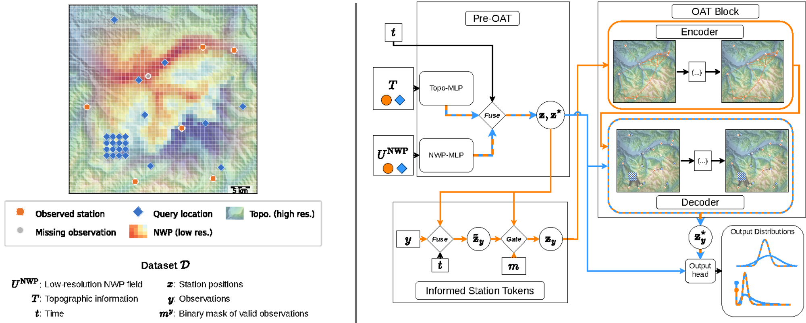

# Observation Assimilation Transformer (OAT)

OAT makes probabilistic weather analysis fields at any location. It uses a coarse numerical weather prediction (NWP) field and sparse station observations. A transformer with geometry-aware sparse attention moves the information from the stations to the query locations. The output is a predictive distribution of temperature and precipitation.



This repository holds the code of the paper "Observation Assimilation Transformer: Probabilistic Weather Analysis from Sparse Station Observations" (Donner et al., 2026, submitted).

## Install

You need Python 3.12 and [Poetry](https://python-poetry.org/) 2.x. A CUDA GPU is optional. Figures 8 and 9 (scaling benchmarks) need a CUDA GPU. Figures 4 and 7 run faster on a GPU.

```bash
git clone https://github.com/SwissDataScienceCenter/observation_assimilation_transformer.git
cd observation_assimilation_transformer
git submodule update --init      # deps/gridded-tnp, for the Gridded TNP baseline
poetry install --with dev
poetry run pytest                # the tests that need real data skip
```

## Train a model

Get the data first (see [Download the checkpoints and the data](#download-the-checkpoints-and-the-data)).

`scripts.train` starts a training run. It selects the entry point and the Hydra overrides for the model, and it gives the run a name. The run name is also the checkpoint folder and the W&B run name.

```bash
poetry run python -m scripts.train --model oat --dataset era5_meteostat/temp_precip
```

- `--model`: `oat`, `uninformed_oat`, `gp`, `gp_oat`, `deep_gp`, `deep_gp_oat`, `ootg`.
- `--dataset`: a dataset variant in `configs/dataset/<family>/`, for example `era5_meteostat/temp` or `cosmo_peakweather/temp_precip`. OOTG needs a variant whose name ends in `_ootg`. The GP models need a variant with one observed variable.
- `--dry-run` shows the command and does not start it. `--submit` sends the run to SLURM.

The checkpoints go to `$OAT_CKPT_ROOT` (default `checkpoints/`). The configs of the paper runs are next to each checkpoint (`config.yaml`).

### Change the settings

Add [Hydra overrides](https://hydra.cc/docs/advanced/override_grammar/basic/) at the end of the command:

```bash
poetry run python -m scripts.train --model oat --dataset era5_meteostat/temp \
    predictor.lr=5e-4 trainer.max_epochs=50
```

The options are the files and keys in `configs/` (for example `configs/predictor/`). To train on other variables, add a dataset variant file to `configs/dataset/<family>/`. Its `defaults` list must have the entry `<family>/settings@_here_`, as in `configs/dataset/era5_meteostat/temp.yaml`. Then `--dataset <family>/<file name>` selects it.

## Evaluate a model

`configs/checkpoints.yaml` gives a name to each checkpoint. Evaluate a checkpoint on the test split with:

```bash
poetry run python -m scripts.evaluate_test_set --dataset era5_meteostat --model oat_temp_precip
```

The metrics go to `data/results/<run name>_metrics_test.csv` and `.summary.json`. To evaluate your own run, give the checkpoint path directly:

```bash
poetry run python -m scripts.evaluate_test_set checkpoints/<group>/<run name>/<file>.ckpt
```

The `config.yaml` of the run must be in the same folder as the `.ckpt` file. You can also add one line with the checkpoint path to `configs/checkpoints.yaml`.

## Download the checkpoints and the data

The paper checkpoints, the result files and the Europe dataset (ERA5 and Meteostat) are on Zenodo:

| Record | DOI | Content | Licence |
|---|---|---|---|
| OAT checkpoints and results v1.0 | [10.5281/zenodo.23470442](https://doi.org/10.5281/zenodo.23470442) | the 18 paper checkpoints with their configs, the per-station result files | CC BY 4.0 |
| OAT Europe dataset | [10.5281/zenodo.23470444](https://doi.org/10.5281/zenodo.23470444) | ERA5 (N320, 2019–2024, 1 h), static fields, Meteostat hourly observations, station quality | CC BY-NC 4.0 |

```bash
poetry run python -m scripts.download_artifacts --what all --dest .
```

The script checks each file and puts the files into `checkpoints/` and `data/`. These are the default folders. To use other folders, set `OAT_CKPT_ROOT` and `OAT_DATA_ROOT`.

The checkpoint record is about 61 MB. The data record is about 13 GB (the ERA5 zarr is about 12 GB). The unpack needs about two times the size of the largest tar file as free disk space, because the tar file stays until it is unpacked.

The result files go to `<dest>/data/results`. The scripts `build_results_table` and `evaluate_test_set` always use `<repo>/data/results`. With another `--dest`, give `--results-dir <dest>/data/results` to `build_results_table`. Or download the checkpoints record with `--dest .`.

The Swiss dataset (COSMO-1E and PeakWeather as prepared for the paper) is not public. You cannot compute the Swiss rows of the results table again without MeteoSwiss data. The released result files give these rows.

## Reproduce the paper

Each paper figure and the results table has one script in `figures/`. For example:

```bash
poetry run bash figures/generate_table1.sh   # results table, figures/out/table1_*
poetry run bash figures/generate_fig4.sh     # calibration (PIT) figure
```

When an input is missing, a script stops with a message that names the input. [REPRODUCE.md](REPRODUCE.md) lists all scripts, their inputs and their run times.

To build the results table from the released result files only, without evaluation:

```bash
poetry run python -m scripts.build_results_table --results-dir data/results
```

## Citation

If you use this code, please cite the paper. GitHub shows the citation from [CITATION.cff](CITATION.cff).

```bibtex
@article{donner2026oat,
  title   = {Observation Assimilation Transformer: Probabilistic Weather Analysis
             from Sparse Station Observations},
  author  = {Donner, Christian and Cattaneo, Michele and Samarin, Maxim and
             Zanetta, Francesco and Llor{\'e}ns Jover, Ic{\'i}ar and
             Aznar Siguan, Gabriela and Volpi, Michele},
  year    = {2026},
  note    = {Submitted}
}
```

## Licence

The code is under the MIT licence, see [LICENSE](LICENSE). The Zenodo records have their own licences (see the table above).
